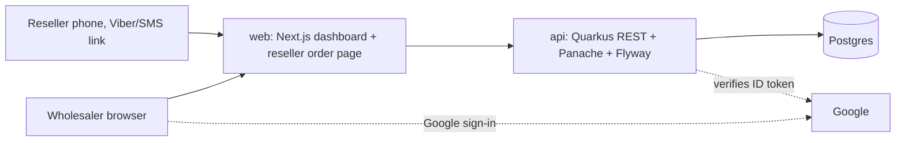
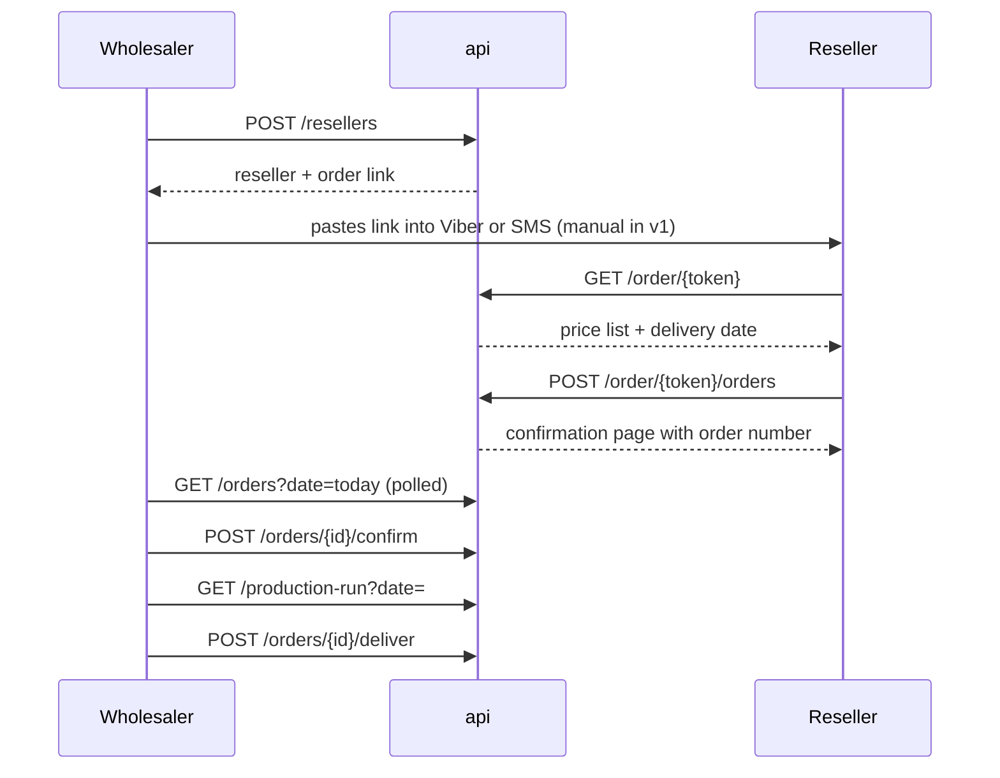

# county v1: wholesaler ordering for resellers

Date: 2026-10-16
Status: approved design, awaiting implementation plan

## 1. Purpose

county is a product for Philippine SMEs. Version one serves a food wholesaler
(the reference case is a longganisa producer) whose independent resellers
(market stalls, sari-sari stores, carinderias) order from a link sent to their
mobile number. The wholesaler runs the app. Resellers never log in.

Version one is a demo, not a pilot. Success means one person can run this loop
in front of a prospect without a hitch:

invite reseller → reseller orders from the link → wholesaler sees the day's
orders → confirms → sees the production run per product → marks delivered.

### Out of scope for v1

POS and BIR receipts, stock and lot tracking, discrepancy reports, payments
beyond a paid flag, multiple branches or sites, price tiers and minimum order
quantities, SMS sending, subscription billing, accounting integrations,
realtime push.

## 2. Architecture



- One repo, two deployables: `api/` (Quarkus, Java 21, Gradle) and `web/`
  (Next.js, App Router, TypeScript). One Helm chart under `deploy/`.
- Built by the in-cluster Jenkins on xeon to GHCR; deployed to the xeon
  cluster. Postgres on Longhorn storage. Public reseller link exposed through
  a Cloudflare tunnel.
- `api`: RESTEasy Reactive + Jackson, Hibernate ORM with Panache, Flyway,
  Postgres, `quarkus-oidc` with `quarkus.oidc.provider=google` verifying
  Google ID tokens as bearer tokens, SmallRye OpenAPI. Problem Details
  (RFC 9457) for all errors through one exception mapper.
- `web`: Auth.js with the Google provider for the wholesaler session; the
  Google ID token is sent to the API as the bearer token. The wholesaler
  dashboard is client-rendered. The reseller order page is server-rendered
  with minimal JavaScript so it works inside Viber's and Messenger's in-app
  browsers on low-end Android phones.
- The web API client is generated from the API's OpenAPI document during the
  build, so a changed endpoint fails `tsc` in web rather than a demo.
- No realtime. The dashboard polls the orders endpoint every 30 seconds.

### Identity and tenancy

- First Google sign-in creates a `user` row keyed by (provider, subject) in an
  `identity` table and sends the owner to "create your business", which
  creates the tenant. Adding another identity provider later is configuration.
- Every tenant-owned table carries `tenant_id`. The tenant comes from the
  authenticated user, never from a request body or path. No endpoint accepts
  a tenant id.

## 3. Domain model

All entities are tenant-scoped except `user` and `identity`.

| Entity | Fields | Notes |
|---|---|---|
| Tenant | name, timezone (default Asia/Manila), cut-off time, delivery days (set of weekdays), currency (PHP) | One per business. Settings live here. |
| User | display name, email; identities (provider, subject) | Owner of a tenant. v1 has one user per tenant. |
| Product | name, unit (pack, kg, pc), unit price, active | The price list is the active products. |
| Reseller | name, mobile number, order token, status (invited, active, blocked) | The token is what the order link carries. Blocked means the link stops working. First order moves invited to active. |
| Order | reseller, order number, placed at, requested delivery date, status, total, note, paid flag, idempotency key | Status: placed, confirmed, delivered, cancelled. |
| OrderLine | product, quantity, unit price at order time, line total | Price is copied at order time. |

The production run (orders for a delivery date, summed per product) is a
query over confirmed orders, not a table.

### Rules

- Delivery date is computed server-side in the tenant's timezone. Before the
  cut-off time, it is the earliest configured delivery day at least one day
  after today. At or after the cut-off, it is the earliest configured
  delivery day at least two days after today. The reseller sees the computed
  date before ordering and cannot choose another.
- Totals are computed server-side from lines. Client-sent totals are ignored.
- Status transitions, who may trigger them, and from which state:
  - placed → confirmed: wholesaler
  - confirmed → delivered: wholesaler, may set paid
  - placed → cancelled: reseller or wholesaler
  - confirmed → cancelled: wholesaler
  - anything else: rejected
- A blocked reseller's token is rejected everywhere.

## 4. API

Authenticated (wholesaler, Google ID token):

```
POST /tenants                       create business after first sign-in
GET  /me                            user + tenant
GET/POST /products, PUT /products/{id}
GET/POST /resellers, PUT /resellers/{id}, POST /resellers/{id}/block, /unblock
GET  /orders?date=&status=          list for the dashboard
GET  /orders/{id}
POST /orders/{id}/confirm
POST /orders/{id}/deliver           body: { paid: boolean }
POST /orders/{id}/cancel
GET  /production-run?date=          per-product totals of confirmed orders
```

Unauthenticated (reseller, token in path):

```
GET  /order/{token}                 price list, computed delivery date, recent orders
POST /order/{token}/orders          body: lines[], note, idempotencyKey
POST /order/{token}/orders/{id}/cancel   only while placed
```

Transitions are separate endpoints, not a generic status patch, so each rule
lives in one place and has its own tests.

## 5. Data flow



The reseller page is stateless: token in the URL, no cookie, no account.
Reopening the link shows the price list and recent orders, with a cancel
button on orders still in placed.

## 6. Error handling

| Case | Behaviour |
|---|---|
| Unknown or blocked token | 404 for both, so tokens can't be probed. Page: "This link is no longer active, contact your supplier." |
| Invalid order (no lines, zero qty, inactive product) | 422 with field-level messages; page re-renders with errors in place. |
| Double submit | Same idempotency key returns the original order (200), never a second order. |
| Illegal transition | 409 with the current status. Dashboard refreshes the row. |
| Another tenant's resource | 404, never 403. |
| Expired or invalid Google token | 401; web re-signs in silently. |
| Cut-off boundary | Compared in the tenant's timezone; tested at one minute before, at, and one minute after. |

All API errors are Problem Details JSON from a single exception mapper. No
custom error codes beyond HTTP status and field names.

## 7. Testing

TDD throughout: the failing test is written before the code it covers.

- Domain rules as plain JUnit without Quarkus: delivery-date computation,
  cut-off in Asia/Manila, transitions, totals, token validation.
- API tests with `@QuarkusTest` and REST-assured against a real Postgres
  given by `COUNTY_TEST_JDBC_URL`. Dev Services are disabled in the test
  profile so the suite never needs Docker (xeon has no Docker daemon).
  Flyway migrates a fresh schema per run. Jenkins provides a throwaway
  Postgres pod.
- Tenant isolation: for every tenant-scoped endpoint, a test proves tenant B
  gets 404 on tenant A's resource. These are required for merge.
- Reseller flow: token endpoints with no auth header, blocked token, double
  submit, invalid delivery date.
- web: Vitest for logic; one Playwright script that runs the demo loop end to
  end. That script is the acceptance test for v1 and the pre-demo check.
- `npm run build` in web before any push (vitest does not type-check).

## 8. Deployment

Helm chart with `api`, `web` and `postgres` (Longhorn PVC). Images tagged by
full 40-character commit SHA. Secrets (Google client id and secret, database
password) from Kubernetes secrets with UPPER_SNAKE keys. Public hostname for
the reseller link through the existing Cloudflare tunnel.

## 9. Open items, deferred by decision

- SMS gateway for sending links.
- Stock and lots, the next slice after v1.
- Multiple users per tenant and roles.
- Payments beyond the paid flag.
